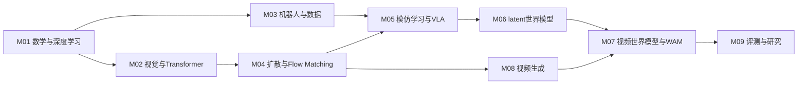

# 具身智能、世界模型与视频生成：从入门到研究实践

一套以问题、前置知识、实验和验收组织的原创中文课程。先能解释公式与接口，再读关键论文，最后用受控实验检验一个具体命题。

**从这里开始：[入门与自测](docs/START_HERE.md)。** 主线9个模块，教学预算24周×每周8小时；已有基础可按自测跳过。研究进阶另安排12周，时间为规划估计，不承诺在固定周数掌握所有模型。

| 你现在要做什么 | 入口 |
|---|---|
| 找自己的起点 | [入门与自测](docs/START_HERE.md) |
| 看依赖关系与三条分支 | [路线图](docs/ROADMAP.md) |
| 每周实际做什么 | [24周计划](docs/WEEKLY_PLAN.md) |
| 从基础到研究深入一条线 | [12周研究进阶](docs/ADVANCED_RESEARCH.md) |
| 按必读/选读找官方资料 | [资料索引](docs/RESOURCES.md) |
| 找可lip某一期对应位置 | [原仓库映射与补缺](docs/SOURCE_MAP.md) |
| 今天先跑一个实验 | [CPU实验](labs/README.md) |
| 确认环境与算力 | [环境路线](docs/ENVIRONMENT.md) |
| 看已验证与未验证 | [验证报告](docs/VALIDATION.md) |

## 学习主线

图只显示主要教学连接，完整前置见[课程元数据](curriculum.json)。M08先于M07学习，用视频生成的基础解释WAM，避免先读前沿模型再追前置。

## 一次学习如何闭环

每个模块：先做自测 → 学3–5节核心内容 → 按顺序读少量必读资料 → 交练习产物 → 按验收判断 → 再打开选读。资料目录提供导航，完成标准是能解释、实现和复核。

本仓库有三个无需外部依赖的标准库实验：行为克隆与反馈数据、一维Flow Matching、学到的动力学与规划。它们解释机制，不被称为完整VLA/Dreamer/视频模型复现。完整模型的GPU实验是后续可选实践。

## 来源与范围

起点来自[可lip论文资料仓库](https://github.com/skJack/-lip-)的专题结构，本课程重新安排教学依赖，补入数学、视觉与训练、控制/模仿学习、扩散、实验评测及研究方法。保留原仓库导航，不镜像其幻灯片、图片或论文笔记。

补充资料只选原论文、作者项目、官方文档和课程；每条记录有用途、模块和核验说明。[来源数据](docs/sources.json)。核验链接及主题不等于复现论文实验；外部依赖、许可与榜单会变化。

课程文本与示例代码的使用说明见[LICENSE](LICENSE)；外部论文和项目按各自条款使用。[引用说明](ATTRIBUTION.md)
