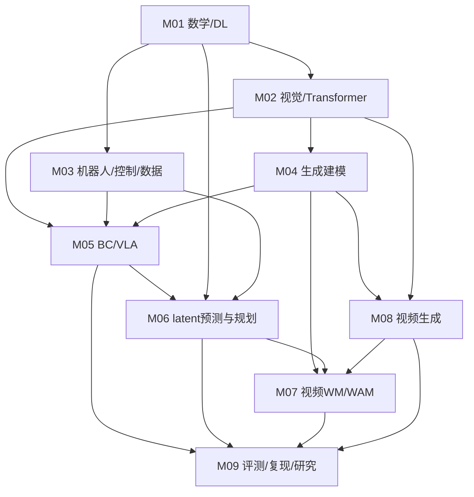

# 总路线：理解、实现、检验

课程的核心是三个接口：观测怎样表示、动作怎样生成、未来怎样预测。数据和评测贯穿这三件事。阅读模型更新史只能补充地图，不能替代前置练习。

## 九个模块与过关产物

| 模块 | 前置 | 估计小时 | 过关产物 |
|---|---|---:|---|
| [M01 数学、Python与深度学习](modules/01-math-and-deep-learning.md) | 基础编程或M01前置 | 32 | 梯度核查、训练循环与泄漏诊断卡 |
| [M02 视觉表征与Transformer](modules/02-vision-and-transformers.md) | M01 | 16 | 注意力手算、token预算与模型接口卡 |
| [M03 机器人、控制、数据与仿真](modules/03-robotics-foundations.md) | M01 | 16 | 坐标/控制表、episode划分审计 |
| [M04 扩散与Flow Matching](modules/04-diffusion-and-flow.md) | M01、M02 | 24 | 生成训练目标对照、速度场CPU实验 |
| [M05 模仿学习与VLA](modules/05-imitation-and-vla.md) | M02、M03、M04 | 24 | BC闭环实验、动作表示与VLA比较卡 |
| [M06 latent世界模型与规划](modules/06-latent-world-models.md) | M01、M03、M05 | 24 | 动力学预测、开环/滚动规划对照 |
| [M08 视频生成](modules/08-video-generation.md) | M02、M04 | 16 | 视频token与条件接口、质量评测方案 |
| [M07 视频世界模型与WAM](modules/07-video-world-models-and-wam.md) | M04、M06、M08 | 16 | 动作条件/联合生成/规划路线比较 |
| [M09 评测、复现与研究](modules/09-evaluation-and-research.md) | M05、M06、M07、M08 | 24 | 可复跑项目、全种子结果与边界报告 |

总计192小时，不包含全部选读、完整模型预训练或外部依赖排障。建议预留15%–25%的缓冲；可拆为更长周期。9个模块的章节有自测，已有知识可用同等产物替代。

## 分层依赖

M09的方法从第一次实验就使用，图中的汇入表示完整主线结业项目。专项分支完成其模块后也可用M09验收，不必为了视频生成先学全部机器人内容。

## 为什么这么安排

M03补观测/动作、坐标、时间与环境，这些是读任何机器人模型的接口。M04先讲生成训练目标，避免把连续动作生成只看成网络名。M05再比较BC、动作块、离散token与flow。M06将“预测”与“用预测”拆开。M08先了解视频的压缩、时空结构和条件，M07才能辨别视频WM和WAM到底把动作放在哪里。

JEPA、Dreamer和视频世界模型是不同研究选择，并非都必须串成一条升级链。课程串联的是理解需要的前置知识。

## 三种成果等级

| 等级 | 证据要求 | 不能据此声称 |
|---|---|---|
| 入门理解 | 自测、手算、接口卡 | 已复现论文性能 |
| 独立实践 | 可运行代码、固定配置、全部种子和失败 | toy结论可直接迁移真机 |
| 研究深入 | 公平基线、消融、数据/任务外验证、可复跑报告 | 只靠好看的demo证明机制 |

完成主线后选择[12周研究项目](ADVANCED_RESEARCH.md)，只深入一条线。最终成果是一份范围明确的研究报告；精深来自持续推导、复现和否证，不由论文数量衡量。
